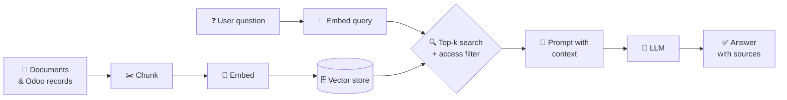

<div align="center">

<a href="https://www.linkedin.com/in/mohdsohail19121/"></a>

<a href="https://www.linkedin.com/in/mohdsohail19121/"></a>


</div>

<br>

## 👨‍💻 About me

<table>
<tr>
<td width="55%" valign="top">

I'm a **Python & Odoo developer** working across **Odoo 17, 18, 19 and 20**.

- 🧩 I build **custom Odoo modules** for HR, projects, timesheets, CRM, sales and customer portals.
- 🤖 I connect Odoo to **LLMs**: chat assistants that answer questions about company data in plain language.
- 📚 I build **RAG pipelines** that answer from your own documents and cite their sources.
- 🔌 I build **MCP servers** that let Claude, ChatGPT, Copilot and Cursor read and update Odoo safely.
- 🔐 I care about AI that **respects permissions** and **logs what it does**.

</td>
<td width="45%" valign="top">

```python
class MohdSohail:
    role  = "Python & Odoo Developer"
    odoo  = ["17", "18", "19", "20"]
    ai    = ["LLM", "RAG", "MCP",
             "Agents", "Tool calling"]
    stack = ["Python", "PostgreSQL",
             "OWL", "QWeb", "JSON-RPC"]

    def build(self):
        return "Odoo that works with AI"
```

</td>
</tr>
</table>

## 🚀 What I build

<table>
<tr>
<td width="50%" valign="top">

### 🧩 Odoo modules
ORM models, security rules, wizards, controllers, QWeb reports, OWL widgets and website portals, on Odoo 17 through 20, including migrations between versions.

</td>
<td width="50%" valign="top">

### 🔌 MCP servers & AI agents
Native Model Context Protocol endpoints inside Odoo, with OAuth 2.1 login, MCP-only API keys, per-user access rules and an audit log of every call.

</td>
</tr>
<tr>
<td width="50%" valign="top">

### 🤖 LLM assistants
HR and employee chatbots, AI resume parsing and natural-language queries over ERP data, built on OpenAI, OpenRouter and Claude.

</td>
<td width="50%" valign="top">

### 📊 Dashboards & forecasting
Sales, purchase and manufacturing forecasts, sales-growth dashboards and Excel / PDF reports.

</td>
</tr>
</table>

## 🧠 How my RAG pipelines work



## ⭐ Featured projects

<div align="center">

<a href="https://github.com/sohail19121/ai_hr_chatbot"></a>
<a href="https://github.com/sohail19121/Forecasting-Of-Sale-Purchase-Manufacturing"></a>
<a href="https://github.com/sohail19121/Linkedin-Integration"></a>
<a href="https://github.com/sohail19121/rent_management"></a>
<a href="https://github.com/sohail19121/Crm-Lead-Edit-Form"></a>
<a href="https://github.com/sohail19121/Sale-Recognition"></a>

</div>

## 🛠️ Tech stack

<div align="center">


<br><br>


</div>

## 📈 GitHub activity

<div align="center">


</div>

## 🤝 Let's work together

<div align="center">

I'm open to **Odoo projects**, **LLM & RAG integrations** and **MCP / AI agent development**.

<a href="https://www.linkedin.com/in/mohdsohail19121/"></a>

</div>


